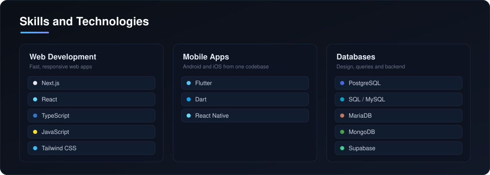

## About Me

Hi, I'm Ijlal. I build web and mobile apps, and I enjoy taking an idea all the way from a rough sketch to something people can actually use.

On the web side I mostly work with Next.js, React and TypeScript, styled with Tailwind CSS. For mobile I use Flutter with Dart, and React Native when a project fits better in the JavaScript world. Behind the apps I set up and manage databases like PostgreSQL, MySQL, MariaDB, MongoDB and Supabase.

I care about clean code, fast load times and interfaces that feel simple to use. Right now I'm open to freelance work and interesting collaborations, so feel free to reach out.

 

## Projects

| Project | What it does | Built with |
|:--|:--|:--|
| [Project One](https://github.com/codewithijlal/project-one) | Write one short line about this project | Next.js, TypeScript, Supabase |
| [Project Two](https://github.com/codewithijlal/project-two) | Write one short line about this project | Flutter, Dart |
| [Project Three](https://github.com/codewithijlal/project-three) | Write one short line about this project | React Native, MongoDB |

## GitHub Activity

  

## Get in Touch

If you have a project in mind or just want to talk about code, I'm always happy to hear from people.

  
  
  

